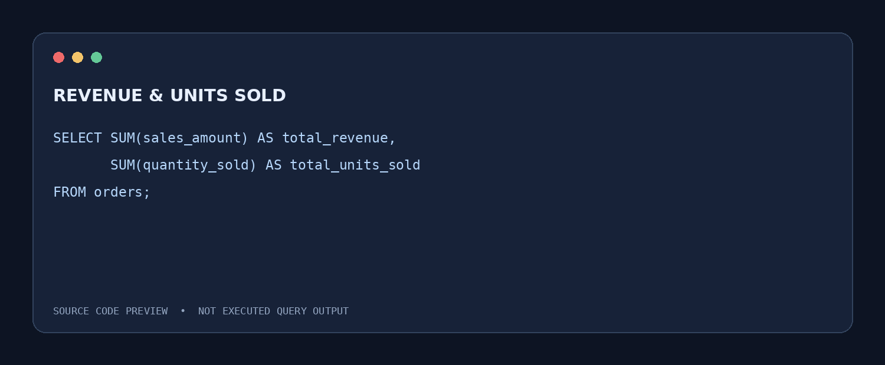
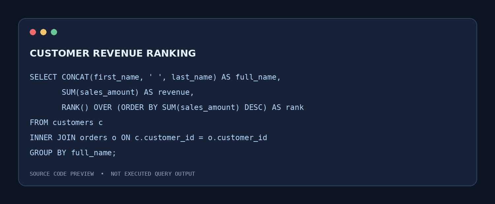
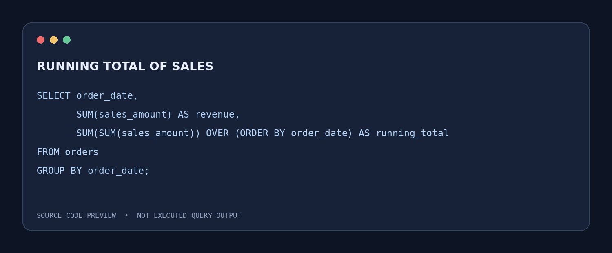

# MotivaAutos — SQL Sales & Customer Analytics
### PostgreSQL | Data Analytics Portfolio Project

**MotivaAutos** is an automotive sales analytics case study using PostgreSQL to explore vehicle sales, customer purchasing patterns, revenue trends, and customer segmentation. This repository preserves the original SQL work and highlights the analytical techniques used.

> **Project scope:** SQL analysis only. The uploaded source contains queries, not the underlying database or exported query results. Screenshots below are **code previews**, not database execution results; no numerical findings are claimed without data.

## Project objectives
- Analyze total sales revenue, units sold, and orders.
- Compare sales performance by car brand, model, and color.
- Identify customers with high spending and customers with no purchases.
- Segment customers by age and revenue-based loyalty tiers.
- Explore annual and monthly revenue patterns and running sales totals.
- Rank customers and cars by sales revenue.

## Tools and skills
**PostgreSQL / SQL:** SELECT, WHERE, DISTINCT, ORDER BY, LIMIT, GROUP BY, HAVING, INNER JOIN, LEFT JOIN, UNION, aggregate functions, scalar subqueries, CASE, COALESCE, CAST, EXTRACT, RANK(), and windowed running totals.

## Data model
The queries reference three tables:

| Table | Fields referenced | Purpose |
| --- | --- | --- |
| `customers` | `customer_id`, `first_name`, `last_name`, `email`, `age`, `city` | Customer profiles and segmentation |
| `cars` | `car_id`, `car_brand`, `car_model`, `car_color`, `unit_price` | Vehicle catalog and pricing |
| `orders` | `order_id`, `customer_id`, `car_id`, `order_date`, `sales_amount`, `quantity_sold` | Purchases, quantities, and revenue |

**Relationships inferred from the SQL:** `orders.customer_id` joins `customers.customer_id`; `orders.car_id` joins `cars.car_id`. The database schema and source data were not supplied.

## SQL analysis
**[View the complete SQL script](MotivaAutos.sql)**

| Business question | SQL approach |
| --- | --- |
| What is total revenue and how many units were sold? | `SUM(sales_amount)`, `SUM(quantity_sold)` |
| Which car models generate the most revenue? | Join `cars` and `orders`; aggregate and rank |
| Which car colors are most popular? | Sum quantities by `car_color` |
| Which customers have not placed orders? | `LEFT JOIN` with `IS NULL` |
| Which customers contribute the most revenue? | Join and aggregate by customer; `RANK()` |
| How do sales accumulate over time? | Group by order date; windowed running total |
| How can customers be grouped? | `CASE` for age and spending tiers |
| What are the revenue patterns by year and month? | `EXTRACT` and grouped `SUM` |

## Selected SQL previews
The images below display excerpts from the original script. They do **not** show executed results.

### Revenue and sales volume

### Customer sales ranking

### Running sales total

## Potential business applications
1. Prioritize high-performing car models for inventory planning.
2. Use car-color demand patterns to inform stocking decisions.
3. Identify high-value customers for retention campaigns.
4. Monitor changes in revenue over time to support sales planning.
5. Investigate customers with no purchases for possible re-engagement.

These are **possible applications**, not verified findings or measured business outcomes.

## Important analysis notes
- The monthly trend query groups by **month number only**, so matching months across different years are combined. To report separate year-month periods, group by both year and month or use `DATE_TRUNC('month', order_date)`.
- The loyalty-tier query uses `SUM(sales_amount)` after a `LEFT JOIN`; customers without orders can have `NULL` revenue and no assigned tier. `COALESCE(SUM(sales_amount), 0)` would include them as Bronze.
- The original script contains some statements without terminating semicolons and a typo (`Affrodable`). The source file is retained unchanged to reflect the submitted work.
- No underlying data or execution outputs were provided, so reported values, charts, and verified query results are intentionally omitted.

## Repository files
| File | Description |
| --- | --- |
| [MotivaAutos.sql](MotivaAutos.sql) | Original PostgreSQL analysis script |
| [revenue-query.png](screenshots/revenue-query.png) | SQL revenue query preview |
| [customer-ranking-query.png](screenshots/customer-ranking-query.png) | SQL customer ranking preview |
| [running-total-query.png](screenshots/running-total-query.png) | SQL cumulative revenue preview |

## Project context
Portfolio SQL analytics exercise focused on automotive sales and customer behavior. The dataset's provenance and whether the company is fictional were not established from the provided script.

**Portfolio:** [Emmanuel Sey Williams](https://seywilliams.github.io/)
